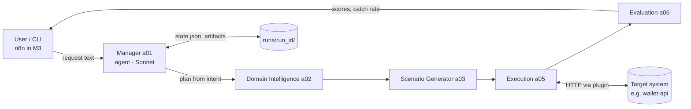

# Architecture

> v1 · 2026-11-24 · Max 10 pages. The M1 chain (Scenario → Execution →
> Evaluation) and the M2 additions — Manager (a01) and Domain Intelligence
> (a02) — are all live on `main` (PRs #25, #26). Stage contracts, context
> passing and error handling: [`pipeline.md`](pipeline.md).

## 1. System context

ECVT validates an existing system; it never generates product code.
System-specific knowledge lives in `plugins/`, never in an agent (root
`CLAUDE.md` rule 5).

## 2. Components

| Component | Job | Model call | Code |
|---|---|---|---|
| CLI | Entry point. Today runs the fixed M1 chain; in M2 hands the request to the Manager | none | `ecvt/cli.py` |
| Manager (a01) | Classify intent, extract slots, decide retry/stop, write the summary | Agent SDK `query()`, Sonnet | `agents/a01_manager/` |
| Domain Intelligence (a02) | OpenAPI spec → DomainModel (entities, workflows, rules, gaps) | Messages API, forced tool use, Haiku | `agents/a02_domain_intelligence/` |
| Scenario Generator (a03) | Spec → ScenarioSet across 7 categories (the DomainModel is not passed in; ADR 0012) | Messages API, forced tool use, Haiku | `agents/a03_scenario_generator/` |
| Execution (a05) | Fire each scenario at the target, record what happened | **none** | `ecvt/execution.py` |
| Evaluation (a06) | Rule checks, then LLM-as-judge on what rules cannot decide | Messages API, Haiku | `agents/a06_evaluation/`, `ecvt/scoring.py` |
| Plugins | Target-specific adapters and rules | none | `plugins/` |
| Eval harness + gates | Agent eval datasets, milestone gates | judge calls only | `scripts/eval_runner.py`, `scripts/gate_check.py` |

Model choice: ADR 0005. Why subagents use the Messages API and only the
Manager uses the Agent SDK: ADR 0009.

## 3. Mechanism map — which pattern, where, why

The course vocabulary (Anthropic, "Agents and workflows") mapped onto ECVT.

| Mechanism | Where in ECVT | Why this choice |
|---|---|---|
| **Workflow vs agent** | Only the Manager is an agent. Every subagent is one model call | Use an agent only where the next step is not known in advance. Here that is intent and retry/stop; everything else is fixed |
| **Chaining** | domain_intel → scenario_gen → execution → evaluation, enforced by `INTENT_PLAN` and `precondition()` in code | Each stage needs the previous stage's output. Order is known up front, so code holds it, not the model |
| **Routing** | Manager `record_intent`: 7 intents, each mapped to a subset of the chain | Requests differ in kind; classification decides which stages run (e.g. `generate_scenarios` runs only domain_intel → scenario_gen) |
| **Parallelization — sectioning** | Evaluation judges scenarios in parallel, at most 6 at a time (`DEFAULT_JUDGE_PARALLEL`) | Each score is independent of the others, so order does not matter. Gain is wall-clock time; the cap of 6 protects rate limits |
| **Parallelization — voting** | Not used yet. Proposed: run each a02 eval case 3× and average | Repeating the same task lowers variance. This is the variant that improves consistency, not sectioning |
| **Evaluator–optimizer** | a02: the Pydantic validator rejects the output and its error goes back to the model verbatim as `tool_result` with `is_error=true`, one retry (M2 design) | A code-based evaluator is cheap and exact; one retry bounds the cost |
| **Environment inspection** | Each `run_<stage>` tool reads `state.json` first; off-plan, out-of-order or exhausted calls return `blocked` | The model's decision is checked against real state before anything runs |
| **Guardrails** | `MAX_MANAGER_TURNS = 24`, `MAX_ATTEMPTS = 2`; `finalize_guard`; a false "completed" is rejected | Stops runaway loops and infinite retry; the model's "done" is verified by code (ADR 0006 spirit) |
| **Hook (PreToolUse)** | `run_<stage>` may be called only by its own subagent; the Manager calling it directly is denied | Authority boundaries are enforced in code, not left to the prompt |
| **Context isolation** | Artifacts are written to `runs/<run_id>/`; the Manager sees only `artifact_ref` + a ≤500-char summary | Keeps the Manager's context small across the whole pipeline (D5) |
| **Structured output** | Pydantic wire models, `extra="forbid"`, no defaults; forced `tool_choice` | A field optional in the schema gets skipped even if the prompt asks for it (a03 lesson) — required means required in the schema |
| **Model routing** | Manager Sonnet; subagents and AgentDefinition adapters Haiku | Hard decisions on the strong model, volume on the cheap one (ADR 0005) |
| **Prompt caching** | Long, repeated system blocks (e.g. SKILL.md) carry `cache_control` | Cuts repeated cost; below the model's minimum length the cache silently does not apply |
| **Concurrency as a test probe** | Execution fires one request N times at once (`scenario.concurrency`) | Not an LLM pattern: it stresses the target to expose race conditions |

## 4. Who decides what

| Layer | Decides | Where |
|---|---|---|
| Model (Manager) | intent, slots, retry or stop, summary | `system_prompt.md` |
| Code | plan, order, preconditions, attempt count, all state writes | `agents/a01_manager/agent.py` |
| AgentDefinition (Haiku) | nothing — thin dispatch adapter required by ADR 0009 | `build_subagents()` |
| Subagent | the domain work of one stage | a02 / a03 / a05 / a06 |

## 5. Data and state

- M1 CLI run: `scenarios.jsonl`, `executions.jsonl`, `scores.jsonl`, `run.json`
  (tokens, cost, timing) in the output directory.
- M2 Manager run: `runs/<run_id>/state.json` (schema
  `agents/a01_manager/pipeline_state.schema.json`), one JSON artifact per stage.
  Only code writes state.

## Open items

- [ ] Persistent stores beyond files (Redis / Postgres) — not decided; no ADR yet
- [ ] n8n trigger in the context diagram once M3-T5 lands
- [ ] Live `full_validation` sequence diagram after the M2 merge
