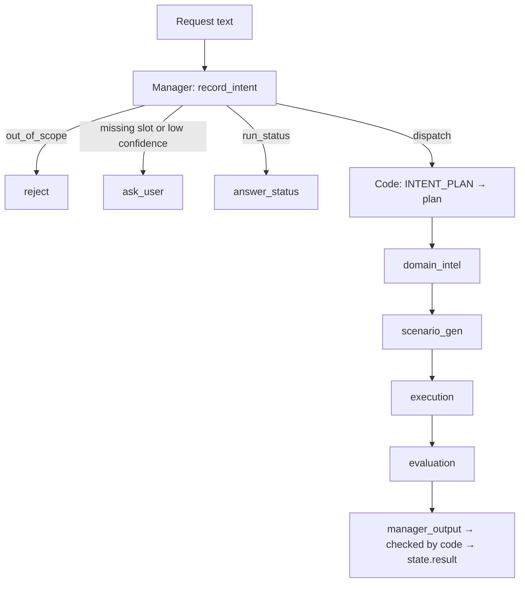

# Validation Pipeline

> v1.3 · 2026-11-25 · Max 2 pages. The M1 chain and the Manager-driven M2 flow
> are both live on `main`. Patterns and rationale:
> [`architecture.md`](architecture.md) §3.

## 1. Flow



Each stage runs only if it is in the plan and every earlier planned stage
succeeded.

## 2. Intent → plan (routing)

| Intent | Stages run | Required slots |
|---|---|---|
| `full_validation` | domain_intel → scenario_gen → execution → evaluation | target_system, plugin |
| `generate_scenarios` | domain_intel → scenario_gen | target_system, plugin |
| `domain_analysis` | domain_intel | target_system, plugin |
| `execute_scenarios` | execution → evaluation | scenario_set_ref, plugin |
| `evaluate_results` | evaluation | execution_ref |
| `run_status` | none — reads an existing run | run_ref |
| `out_of_scope` | none — rejected (wrong domain, stage not available, framework request) | — |

## 3. Stage contracts

| Stage | Input | Output | Artifact |
|---|---|---|---|
| domain_intel (a02) | OpenAPI spec | DomainModel | `domain_intel.json` |
| scenario_gen (a03) | spec; a02's DomainModel only with `ECVT_A03_DOMAIN_MODEL=on` (ADR 0012) | ScenarioSet, 7 categories | `scenarios.jsonl` |
| execution (a05) | ScenarioSet; `plugin` slot (default `rest_api`) → `plugin.execute` | one execution record per scenario | `executions.jsonl` |
| evaluation (a06) | execution records + plugin name; rules via the `ecvt-eval` MCP server (generic + the plugin's `domain_rules`), then the judge | one score per scenario | `scores.jsonl` |

After the last stage, reporting reads the run directory — no model call:

| Report | Reads | Files |
|---|---|---|
| Business, Dev (M3-T4) | scenarios, executions, scores, `run.json` | `report-business.{md,html}`, `report-dev.{md,html}` |
| Catch rate (X/10) | scores, executions + `ground_truth.yaml` | `report.md` |

Only the catch-rate report reads ground truth; no stage does (ADR 0007). Business
recommends by the worst severity found: critical → not ready, high → fix before
release, medium/low → releasable with known issues.

M2 runner contract (every stage):

```python
def run(stage_input: dict) -> dict
# stage_input = {"run_id", "stage", "slots", "upstream": {stage: artifact_path}}
# returns       {"artifact", "summary", "metrics", "usage"}
# on failure    raise StageError(msg, retryable=True | False)
```

## 4. Context passing

The Manager owns the run. Artifacts stay on disk; the next stage receives
upstream **paths**, and the Manager receives only `artifact_ref` plus a
≤500-character summary. No stage reads another stage's context.

## 5. Errors, retries, limits

| Level | Rule | Source |
|---|---|---|
| Target call | Errors are returned as data, never raised. Transient network errors: max 2 retries with backoff. A received HTTP status is never retried — it is the observation | ADR 0006 |
| Structured call | A validator rejection is fed back as the `tool_result` of the rejected `tool_use`, so the model corrects its own object instead of regenerating. Budget per stage: a02 3 (DomainModel validates in two layers Pydantic reports in sequence), a03 4 (`repeat`/`concurrency` are required per scenario) | `structured_call` |
| Stage tool call | A stage is a whole subagent run, so the CLI's 60s MCP default is raised; a call cancelled anyway is recorded `failed` and retryable, never left `running` | `STAGE_TOOL_TIMEOUT_MS` |
| Stage | `StageError(retryable=True)` (rate limit, timeout, schema-invalid tool output) → one retry; anything else stops the plan. The failure carries the last validator error, not just the attempt count | `MAX_ATTEMPTS = 2` |
| Scoring server | ecvt-eval does not start or refuses an input → `EvalServerError`; the chain stops, the Manager's evaluation stage fails non-retryable. No in-process fallback (ADR 0014) | `agents/a06_evaluation/agent.py` |
| Plugin | Unknown, or registered without an implementation → the CLI exits before any model call; inside a stage it is `StageError(retryable=False)`. Never a fallback to another plugin. A domain rule that raises is recorded `inconclusive` | `plugins/_base/plugin.py` |
| Precondition | Not in plan, upstream failed, attempts exhausted → `blocked` | `precondition()` |
| Manager | At most 24 turns; if no `manager_output` arrives, `finalize_guard` closes the run as failed; a "completed" claim that contradicts state is rejected | `MAX_MANAGER_TURNS = 24` |
